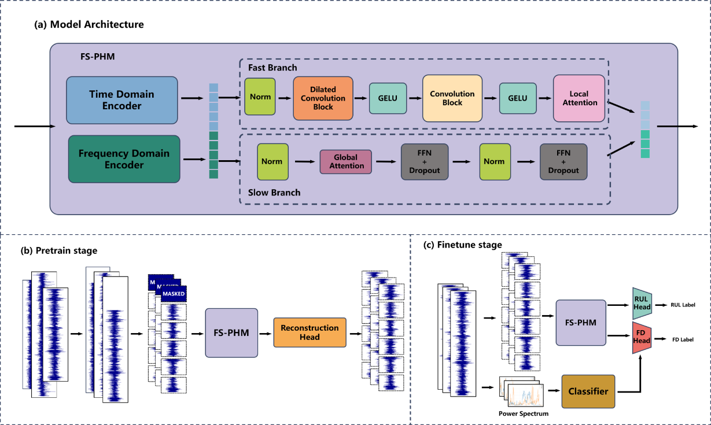
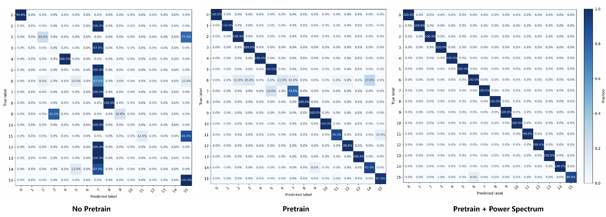
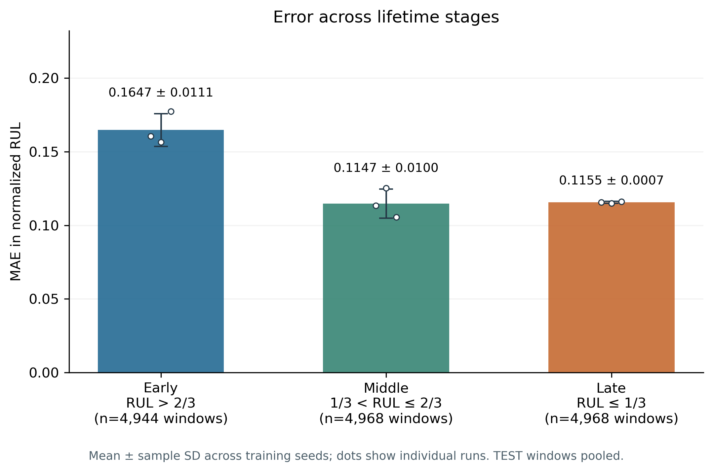

# FS-PHM

**面向旋转机械故障诊断与剩余寿命预测的物理时间对齐预训练框架。**

[English](README.md) · [完整结果表](docs/results.md) · [对比模型说明](docs/baselines.md)

FS-PHM 将不同采样率、多通道振动窗口转换为物理时长对齐的 token，通过快慢双分支主干学习共享表征。下游支持少样本故障诊断（FD）与单窗口剩余寿命预测（RUL）。



*总体架构图提取自项目论文。FD 使用 LoRA 与可选功率谱旁路；本文档推荐的 RUL 流程冻结主干，训练 token 统计特征与幅值特征融合的回归头。两类任务的适配方式分别配置。*

## 功能

- **物理时间对齐**：FD 窗口通常为 0.2 s，RUL 为 0.1 s；可变形时域编码、FFT 与 Morlet CWT 融合，有效性掩码支持不同长度和通道数。
- **混合自监督预训练**：掩码时频重构、增强视图对比和有效 RUL 轨迹对的单调约束；支持 FD/RUL 与任务内数据集均衡采样。
- **少样本诊断**：固定测试集，训练池内抽取每类 K 个窗口或指定比例；LoRA、线性/余弦分类头及支持集拟合的功率谱旁路。
- **单窗口 RUL**：冻结预训练主干，融合 token 的均值、标准差、最大值与同窗幅值统计，采用 MAE 训练有界回归头。
- **对比模型**：CNN-LSTM、Transformer、ResNet18、WDCNN、UniFault、SC-MambaFew、MOMENT/T5、DA-RUL、CNN-BiLSTM、Dual-Mixer，以及独立的 RmGPT 论文结构实现。

## 目录

```text
FS-PHM/
├── README.md                       # 中文
├── README.en.md                    # English
├── requirements.txt                # 主模型和对比模型的通用依赖
├── model/
│   ├── architecture.py             # Tokenizer、双分支主干、FD/通用 RUL 头
│   ├── data.py                     # H5 索引、变长加载、标签隔离
│   ├── train_pretrain.py           # 单卡 / DDP 预训练
│   ├── train_finetune.py           # FD 少样本、比例及全训练池微调
│   ├── train_rul_frozen.py         # 推荐的冻结主干 RUL 入口
│   ├── rul_frozen.py               # RUL 幅值处理、统计池化与融合回归头
│   ├── train_rul_full.py           # 通用 RUL：LoRA / linear / full
│   ├── train_fd_full.py            # 通用 FD 全训练池入口
│   ├── make_fd_split.py            # 创建固定训练池 / 测试划分
│   ├── make_few_shot.py            # K-shot / 训练比例支持集
│   ├── comparisons/architectures.py # 三个通用基础网络
│   └── paper_baselines/
│       ├── pretrain.py            # 对比模型无标签预训练
│       ├── runner.py              # FD/RUL 对比训练与评估
│       ├── rmgpt/                 # RmGPT 架构、预训练、prompt/full 微调
│       ├── vendor/                # 实际使用的上游模块及出处
│       └── hf_configs/            # MOMENT/T5 架构配置
├── docs/                           # 图、结果与来源说明
└── tests/                          # 核心 CPU 验证
```

保留训练运行所需的归一化、划分、日志、损失和指标工具。原始数据、权重、历史运行输出、调参矩阵和诊断脚本不随此代码副本分发。`docs/source_manifest.json` 记录复制来源和校验信息。

## 安装

推荐 Python 3.10–3.12、PyTorch 2.5 或更新版本。先按服务器的 CUDA/驱动环境安装 PyTorch，再从项目根目录执行：

```bash
pip install -r requirements.txt
```

仅运行 FS-PHM 可安装 `pip install -r model/requirements.txt`。SC-MambaFew 的 CUDA 训练还需安装与 PyTorch/CUDA 匹配的 `mamba-ssm`；`--scan-backend reference` 用于小规模 CPU 检查。MOMENT 默认使用 Hugging Face 预训练权重，需要联网或已有本地缓存；`--hf-init random` 使用所附配置随机初始化。

以下命令从项目根目录运行，采用 Bash 换行格式。Windows PowerShell 可合并为一行，或用反引号替换行末反斜杠。

## 准备 H5 数据

将已经转换好的 H5 数据放在 `splitData/`，或通过 `--root` 指定外部目录。这里不包含原始数据转换器或数据文件。

```text
splitData/
├── JNU_h5/              # 预训练 FD
├── PU_h5/               # 预训练 FD
├── ims_h5/              # 预训练 RUL
├── PHM2012_h5/          # 预训练 RUL
├── CWRU_h5/             # 下游 FD
├── UO_h5/               # 下游 FD，可包含类别子目录
└── XJTU-SY_h5_01/       # 下游 RUL，0.1 s
```

一个样本是一行振动窗口。加载器识别 `DE/FE`、`Horizontal/Vertical`、`vibration`、`signal` 等信号字段；FD 标签通常为 `label`，推荐 RUL 目标为 `rul_norm`，取值为 [0, 1]。H5 需要包含采样率、物理窗口时长及来源/设备等相应元数据，以正确生成采集组和轨迹身份。

预训练索引不返回 `label`、`RUL`、`rul_min`、`rul_sec`、`rul_norm` 等监督值。目标数据集应整体排除出预训练，不能只排除少量支持窗口。

### 固定 FD 测试集与支持集

先按采集记录组划分一次，再从训练池生成支持集。组表示采集文件/来源记录，不能直接当成独立物理轴承数。

```bash
python -m model.make_fd_split \
  --root splitData/CWRU_h5_12kdrive --datasets CWRU \
  --unit group --test-fraction 0.2 --seed 2026 \
  --output runs/manifests/cwru_split.json

python -m model.make_few_shot \
  --task fd --root splitData/CWRU_h5_12kdrive --datasets CWRU \
  --split-manifest runs/manifests/cwru_split.json \
  --shots 4 --seed 2026 --output runs/manifests/cwru_4shot.json
```

更换 `--shots` 可创建 1/2/4/8/16-shot。10% 与全训练池分别用 `--train-fraction 0.1`、`--train-fraction 1.0` 替换 `--shots 4`，并使用不同输出文件名。UO 将根目录和数据集名称替换为 `splitData/UO_h5`、`UO`。

不同标签预算复用同一个 split manifest；测试集不参与支持集抽样。若要复现旧结果，请使用原来的 split/support 文件，重新生成的 1-shot 不会自动保留曾经手动替换的 normal 样本。

## 预训练

四卡混合预训练示例：

```bash
torchrun --standalone --nproc_per_node=4 -m model.train_pretrain \
  --task all --data-root splitData \
  --root splitData/JNU_h5 --root splitData/PU_h5 \
  --root splitData/ims_h5 --root splitData/PHM2012_h5 \
  --exclude-dataset CWRU --exclude-dataset UO --exclude-dataset XJTU-SY \
  --sampling task-dataset-balanced --fd-sampling-fraction 0.5 \
  --epochs 10 --batch-size 512 --workers 16 --seed 2026 \
  --output runs/fs_phm_pretrain
```

`--batch-size` 是每个进程的 batch size，DDP 的有效总 batch 还要乘卡数和梯度累积次数。单卡使用 `python -m model.train_pretrain ... --device cuda:0`。进度、配置、指标和检查点保存在输出目录；用 `--resume runs/fs_phm_pretrain/last.pt` 续训。预训练默认采样方式为 `records`，上述命令显式开启均衡采样。

## FD 微调

```bash
python -m model.train_finetune \
  --task fd --root splitData/CWRU_h5_12kdrive --datasets CWRU \
  --split-manifest runs/manifests/cwru_split.json \
  --few-shot-manifest runs/manifests/cwru_4shot.json \
  --checkpoint runs/fs_phm_pretrain/epoch_0002.pt \
  --adaptation lora --fd-head linear --fd-pooling mean \
  --epochs 50 --batch-size 64 --eval-batch-size 512 \
  --lr 0.002 --backbone-lr 0.00008 --workers 8 --seed 2026 \
  --device cuda:0 --max-eval -1 --output runs/cwru_4shot
```

加入 `--fd-power-spectrum` 启用功率谱旁路；谱标准化与岭回归初始化只使用训练支持集。其置信度门控参数可通过 `--help` 查看。`--fd-head cosine` 启用余弦头。切换支持集文件即可训练其他 shot、10% 或整个 80% 训练池。

固定划分协议下按指定轮数训练后评估完整固定测试集，指标为 Accuracy、宏 F1、宏 AUROC、宏 Recall。用新的输出目录比较不同设置；续训用 `--resume <下游检查点>`。

## RUL 冻结主干训练

推荐入口是 `model.train_rul_frozen`。它已从历史调试脚本中独立出来，直接接收预训练权重，不依赖旧 `runs/rul_debug` 目录或历史配置文件。

```bash
python -m model.train_rul_frozen \
  --root splitData/XJTU-SY_h5_01 \
  --checkpoint runs/fs_phm_pretrain/epoch_0002.pt \
  --split-seed 2026 --seed 2026 --sampling-seed 2026 \
  --epochs 50 --batch-size 64 --workers 8 --device cuda:0 \
  --output runs/xjtu_frozen/seed_2026
```

输入仅为一个双通道振动窗口。固定通道尺度、幅值均值/标准差全部在训练轴承上拟合；主干完全冻结，回归头采用 MAE、AdamW、初始学习率 2e-4。训练池采用工况/轴承平衡的有放回采样，每轮抽取与训练池等量的窗口，不保证每个窗口恰好访问一次。特征放在 RAM，不写磁盘特征缓存。

默认保留全量修正版的学习率设置：20 次更新 warmup、600 次更新的余弦调度尺度，前 325 次更新后学习率固定为 1e-8，完成总计 50 轮。50 轮不代表一直按初始学习率学习。超参数分别由 `--warmup-steps`、`--scheduler-steps`、`--phase-steps`、`--floor-lr` 设置。

RUL 按完整轴承轨迹划分。原固定清单对应 12 个训练轴承、3 个测试轴承，共 206,304/14,880 个窗口；这些数量取决于使用的数据版本。保持 `--split-seed 2026`，更换 `--seed 2027/2028` 和输出目录可做重复训练。测试集仅在拟合结束后评估，不用于选择最佳轮次。

继续训练与独立评估：

```bash
# 续训时保留原训练命令的其余参数，并追加 --resume。
python -m model.train_rul_frozen \
  --root splitData/XJTU-SY_h5_01 \
  --checkpoint runs/fs_phm_pretrain/epoch_0002.pt \
  --workers 8 --device cuda:0 --resume --output runs/xjtu_frozen/seed_2026

# 本入口的 final.pt 已保存完整主干、任务头和归一化参数。
python -m model.train_rul_frozen \
  --root splitData/XJTU-SY_h5_01 \
  --evaluate runs/xjtu_frozen/seed_2026/final.pt \
  --workers 8 --device cuda:0 --output runs/xjtu_evaluation
```

输出包含 `config.json`、`metrics.jsonl`、`last.pt`、`final.pt`、`test_metrics.json`、逐窗口预测 CSV 和逐轴承指标。`--evaluate` 支持此精简入口新生成的检查点；旧调试脚本的检查点封装格式需先转换。

通用 `model.train_rul_full` 保留 LoRA/linear/full 适配入口，其默认任务头与损失不同，不能把该入口的默认配置当成上述融合回归方案。

## 对比模型

通用对比入口包含三种基础网络及论文模型适配器。以下例子直接复用正式 FD split/support：

```bash
python -m model.paper_baselines \
  --models transformer resnet18 cnn_lstm wdcnn unifault \
  --datasets CWRU --regimes 4shot \
  --cwru-root splitData/CWRU_h5_12kdrive \
  --cwru-split runs/manifests/cwru_split.json \
  --cwru-support-template 'runs/manifests/cwru_{regime}.json' \
  --epochs 50 --batch-size 64 --seed 2026 --device cuda:1 \
  --output runs/comparisons_fd

python -m model.paper_baselines \
  --models da_rul cnn_bilstm dual_mixer transformer resnet18 cnn_lstm \
  --datasets XJTU-SY --regimes full --history 1 \
  --xjtu-root splitData/XJTU-SY_h5_01 \
  --epochs 50 --batch-size 64 --seed 2026 --device cuda:1 \
  --output runs/comparisons_rul
```

对比模型预训练：

```bash
python -m model.paper_baselines.pretrain \
  --models unifault moment_community \
  --root splitData/JNU_h5 --root splitData/PU_h5 \
  --root splitData/ims_h5 --root splitData/PHM2012_h5 \
  --holdout-datasets CWRU UO XJTU-SY \
  --epochs 10 --batch-size 64 --device cuda:1 --output runs/comparison_pretrain
```

下游追加 `--pretrain-root runs/comparison_pretrain` 使用对应主干；没有预训练权重的模型从随机初始化监督训练。UniFault 仅用于 FD。历史序列模型的 `--history 1` 是单窗口适配，不等同于原论文完整历史输入协议。比较入口可能创建 `--cache-dir` 下的波形缓存；FS-PHM 训练入口不使用这种磁盘缓存。


RmGPT 已放到 `model/paper_baselines/rmgpt/`，不再使用原 `model.rmgpt_paper.*` 命令路径：

```bash
python -m model.paper_baselines.rmgpt.pretrain \
  --root splitData/JNU_h5 --root splitData/PU_h5 \
  --root splitData/ims_h5 --root splitData/PHM2012_h5 \
  --holdout-datasets CWRU UO XJTU-SY \
  --epochs 10 --batch-size 64 --device cuda:1 --output runs/rmgpt/pretrain

python -m model.paper_baselines.rmgpt.finetune \
  --datasets CWRU --regimes 4shot \
  --cwru-split runs/manifests/cwru_split.json \
  --cwru-support-template 'runs/manifests/cwru_{regime}.json' \
  --checkpoint runs/rmgpt/pretrain/last.pt --adaptation prompt \
  --epochs 50 --batch-size 64 --device cuda:1 --output runs/rmgpt/fd_prompt
```

`--adaptation full` 为全参数微调。RmGPT 的论文结构实现与 `moment_community` 是两个独立模型，其检查点不能互换。所有对比模型的任务范围与适配差异见 [baselines.md](docs/baselines.md)。

## 参考结果与可视化

以下为现有实验记录，非本精简副本重新训练的结果。FD 数值来自所提供论文的当前版本，单位为 Accuracy %，报告三个训练种子的均值 ± 标准差：

| 数据集与模型 | 1-shot | 4-shot | 8-shot | 16-shot | 10% | Full |
|---|---:|---:|---:|---:|---:|---:|
| CWRU · FS-PHM | 87.77 ± 0.25 | 93.29 ± 0.21 | 94.57 ± 0.13 | 95.29 ± 0.29 | 97.21 ± 0.05 | 99.02 ± 0.08 |
| CWRU · + Power Spectrum | 94.15 ± 1.96 | 99.72 ± 0.39 | 99.98 ± 0.03 | 100.00 ± 0.00 | 100.00 ± 0.00 | 100.00 ± 0.00 |
| UO · FS-PHM | 79.09 ± 1.31 | 93.74 ± 1.14 | 96.33 ± 0.76 | 97.64 ± 0.62 | 99.43 ± 0.15 | 99.97 ± 0.06 |
| UO · + Power Spectrum | 89.12 ± 4.25 | 99.93 ± 0.06 | 99.93 ± 0.06 | 100.00 ± 0.00 | 100.00 ± 0.00 | 100.00 ± 0.00 |

| XJTU-SY 全训练池 | MAE ↓ | MSE ↓ | RMSE ↓ |
|---|---:|---:|---:|
| FS-PHM 冻结主干融合回归 | 0.13158 ± 0.00163 | 0.02624 ± 0.00087 | 0.16196 ± 0.00269 |

RUL 在完整固定 TEST 上分别计算每次训练的指标，再对 seed 2026/2027/2028 求均值和样本标准差；不是窗口误差的标准差。复现这些数值需要原预训练权重、数据版本及 split/support，代码副本不包含它们。



*论文中的 CWRU 混淆矩阵示例，分别为无预训练、预训练及预训练加功率谱。它展示某次运行，不替代多种子的均值结果。*



*本月生成的 RUL 阶段误差统计图。阶段按真实归一化 RUL 分段，不表示已识别故障起点。*

更多表格、图和来源见 [结果与图表](docs/results.md)。

## 验证与运行边界

```bash
python -m unittest discover -s tests -v
python -m model.train_pretrain --help
python -m model.train_finetune --help
python -m model.train_rul_frozen --help
python -m model.paper_baselines --models transformer --datasets CWRU --plan-only
```

测试覆盖变长掩码、预训练反向传播、RUL 冻结主干、回归头参数量和完整权重保存/加载。完整 GPU 训练需要服务器和对应 H5 数据。

预训练主模型支持 DDP；对比模型及冻结 RUL 使用单进程运行，可将不同模型或训练种子分配到不同 GPU。`CUDA_VISIBLE_DEVICES=3 ... --device cuda:0` 表示使用物理第 3 号卡；直接 `--device cuda:3` 则使用当前可见设备中的第 3 号卡。
