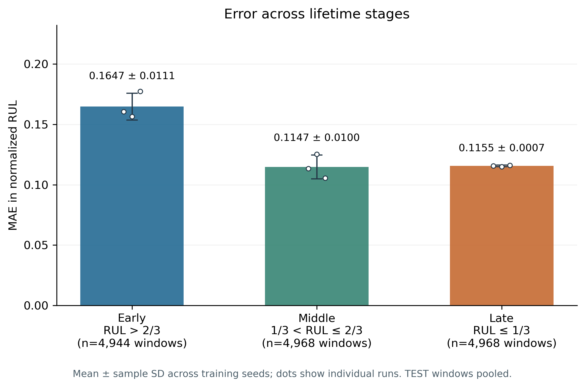

# FS-PHM

**Physical-time-aligned pretraining for rotating machinery fault diagnosis and remaining useful life prediction.**

[简体中文](README-zh.md) · [Complete results](docs/results.md) · [Baseline implementations](docs/baselines.md)

FS-PHM converts vibration windows with different sampling rates and channel counts into physically aligned tokens. A shared fast/slow backbone learns representations for few-shot fault diagnosis (FD) and single-window remaining useful life (RUL) prediction.


*FD uses LoRA and a broadband envelope feature. RUL freezes the backbone and fits a regression head on token and amplitude statistics. The downstream checkpoint includes Source-Mean routing.*

## Features

- **Physical-time alignment:** typically 0.2 s for FD and 0.1 s for RUL; deformable temporal encoding, FFT and Morlet CWT, with masks for variable lengths and channel counts.
- **Mixed self-supervised pretraining:** masked time/frequency reconstruction, view contrast, and a monotonicity objective on valid RUL trajectory pairs; optional task/dataset-balanced sampling.
- **Few-shot diagnosis:** a fixed test partition, K labeled windows per class or a fraction of the training pool, LoRA and a broadband envelope feature in the paper configuration.
- **Single-window RUL:** a frozen foundation encoder; token mean/std/max and same-window amplitude descriptors; bounded regression trained with MAE.
- **Baselines:** CNN-LSTM, Transformer, ResNet18, WDCNN, UniFault, SC-MambaFew, MOMENT/T5, DA-RUL, CNN-BiLSTM, Dual-Mixer, and a separate paper-derived RmGPT implementation.

## Layout

```text
FS-PHM/
├── README.md                       # English
├── README-zh.md                    # Chinese
├── requirements.txt
├── model/
│   ├── architecture.py             # Tokenizer, fast/slow backbone, task wrappers
│   ├── data.py                     # H5 indexing and variable-length batches
│   ├── train_pretrain.py           # Single-GPU / DDP pretraining
│   ├── train_finetune.py           # FD few-shot / fractional / full-pool adaptation
│   ├── train_rul_frozen.py         # Recommended frozen-foundation RUL training
│   ├── rul_frozen.py               # RUL normalization and fusion head
│   ├── train_rul_full.py           # General RUL LoRA / linear / full adaptation
│   ├── train_fd_full.py            # General full-pool FD training
│   ├── make_fd_split.py            # Fixed train-pool/test partitions
│   ├── make_few_shot.py            # K-shot / fractional supports
│   ├── comparisons/architectures.py # Three generic baseline networks
│   └── paper_baselines/
│       ├── pretrain.py            # Label-free baseline pretraining
│       ├── runner.py              # Baseline training/evaluation
│       ├── rmgpt/                 # Architecture, pretraining, prompt/full adaptation
│       ├── vendor/                # Required upstream modules and provenance
│       └── hf_configs/            # MOMENT/T5 architecture configs
└── docs/                           # Figures, results and source notes
```

The export retains required normalization, splitting, logging, losses and metrics. Datasets, weights, historical outputs, parameter sweeps and diagnostic scripts are not distributed.

## Installation

Use Python 3.10–3.12 and preferably PyTorch 2.5 or newer. Install a PyTorch build compatible with the server's GPU driver/CUDA environment, then run from the repository root:

```bash
pip install -r requirements.txt
```

For FS-PHM alone: `pip install -r model/requirements.txt`. SC-MambaFew CUDA training additionally requires a matching `mamba-ssm` installation; `--scan-backend reference` supports small CPU checks. MOMENT uses Hugging Face pretrained weights by default, requiring internet access or a local cache. `--hf-init random` constructs it from the included architecture configuration.

Examples use Bash continuations. On PowerShell, join each command into one line or replace the trailing backslash with a backtick.

## H5 data

Place prepared H5 datasets under `splitData/`, or supply an external location with `--root`. Raw-data exporters and datasets are not included.

```text
splitData/
├── JNU_h5/              # FD pretraining
├── PU_h5/               # FD pretraining
├── ims_h5/              # RUL pretraining
├── PHM2012_h5/          # RUL pretraining
├── CWRU_h5_12kdrive/    # Target FD
├── UO_h5/               # Target FD
└── XJTU-SY_h5_01/       # Target RUL, 0.1 s
```

Each row represents a vibration window. The loader supports signal keys such as `DE/FE`, `Horizontal/Vertical`, `vibration` and `signal`. FD labels normally use `label`; the recommended RUL target is `rul_norm` in [0, 1]. H5 files must provide sampling/window and source/device metadata sufficient to establish physical duration and acquisition/trajectory identities.

The pretraining index does not return supervised values such as `label`, `RUL`, `rul_min`, `rul_sec` or `rul_norm`. Exclude entire target datasets from pretraining, not only their support windows.

### Fixed FD partitions and support sets

Create one acquisition-group split, then draw supports only from its training pool. A group is a source acquisition/file, not necessarily an independent physical bearing.

```bash
python -m model.make_fd_split \
  --root splitData/CWRU_h5_12kdrive --datasets CWRU \
  --unit group --test-fraction 0.2 --seed 2026 \
  --output runs/manifests/cwru_split.json

python -m model.make_few_shot \
  --task fd --root splitData/CWRU_h5_12kdrive --datasets CWRU \
  --split-manifest runs/manifests/cwru_split.json \
  --shots 4 --seed 2026 --output runs/manifests/cwru_4shot.json
```

Change `--shots` for 1/2/4/8/16-shot. For 10% or the entire training pool, replace `--shots 4` with `--train-fraction 0.1` or `--train-fraction 1.0`, using a distinct output file. For UO use `splitData/UO_h5` and `--datasets UO`.

All budgets must share the same split manifest. Test windows never enter support selection. Exact historical reproduction requires the original manifests; regenerating 1-shot does not preserve a manually replaced normal support example.

## Pretraining

The paper uses one GPU, a batch size of 512, and a 20-epoch cosine schedule. Use the checkpoint saved after epoch 2 for downstream experiments.

```bash
python -m model.train_pretrain \
  --task all --data-root splitData \
  --root splitData/JNU_h5 --root splitData/PU_h5 \
  --root splitData/ims_h5 --root splitData/PHM2012_h5 \
  --exclude-dataset CWRU --exclude-dataset UO --exclude-dataset XJTU-SY \
  --sampling task-dataset-balanced --fd-sampling-fraction 0.5 \
  --backbone-ablation no-order --epochs 20 --batch-size 512 --workers 16 \
  --lr 0.0003 --warmup-steps 1000 --seed 42 --device cuda:0 \
  --output runs/fs_phm_pretrain

python -m model.apply_source_mean \
  --checkpoint runs/fs_phm_pretrain/epoch_0002.pt \
  --output runs/fs_phm_pretrain/source_mean.pt
```

The epoch-2 checkpoint inherits the 20-epoch learning-rate schedule. The calibration command folds the fitted source offsets into a new checkpoint shared by FD and RUL. See [Source-Mean routing](docs/source-mean.md).

## FD adaptation

```bash
python -m model.train_finetune \
  --task fd --root splitData/CWRU_h5_12kdrive --datasets CWRU \
  --split-manifest runs/manifests/cwru_split.json \
  --few-shot-manifest runs/manifests/cwru_4shot.json \
  --checkpoint runs/fs_phm_pretrain/source_mean.pt \
  --adaptation lora --lora-rank 8 --lora-alpha 16 \
  --fd-head linear --fd-pooling mean --fd-head-dropout 0.05 \
  --fd-envelope --envelope-mode broadband --no-fd-power-spectrum \
  --epochs 50 --batch-size 64 --eval-batch-size 512 \
  --lr 0.002 --backbone-lr 0.00008 --weight-decay 0.01 --warmup-steps 5 --no-amp --workers 8 --seed 2026 \
  --device cuda:0 --max-eval -1 --output runs/cwru_4shot
```

To train on UO or change the annotation budget, use the corresponding manifests generated in the [fixed split setup](#fixed-fd-partitions-and-support-sets).

The fixed-split protocol trains for the requested number of epochs and then evaluates the full fixed test partition. Metrics are Accuracy, macro F1, macro AUROC and macro Recall. Use a new output for a new setting, or `--resume <downstream checkpoint>` for continuation.

## Frozen-foundation RUL

`model.train_rul_frozen` packages the selected RUL pipeline without historical debug-script or run-directory dependencies.

```bash
python -m model.train_rul_frozen \
  --root splitData/XJTU-SY_h5_01 \
  --checkpoint runs/fs_phm_pretrain/source_mean.pt \
  --split-seed 2026 --seed 2026 --sampling-seed 2026 \
  --epochs 50 --batch-size 64 --workers 8 --device cuda:0 \
  --output runs/xjtu_frozen/seed_2026
```

The input is one two-channel vibration window. Fixed channel scales and amplitude standardization are fitted on training bearings only. The entire foundation is frozen; the head uses MAE and AdamW with an initial learning rate of 2e-4. Condition/bearing-balanced sampling draws N windows with replacement per epoch from the entire N-window training pool; it does not visit each row exactly once. Extracted features reside in RAM, with no feature cache written to disk.

Defaults preserve the adjusted full-pool learning budget: 20 warmup updates, a cosine schedule with a 600-update horizon, then a learning rate of 1e-8 after update 325, completing 50 epochs in total. Thus, 50 epochs does not mean 50 epochs at the initial learning rate. These settings are exposed as `--warmup-steps`, `--scheduler-steps`, `--phase-steps` and `--floor-lr`.

The split holds out complete bearing trajectories. The original data version yields 12 training bearings and 3 test bearings, with 206,304/14,880 windows. Counts depend on the data version. Keep `--split-seed 2026` fixed and change `--seed` to 2027/2028 with distinct output directories for repeated training. TEST is evaluated after fitting and is not used to select the best epoch.

Resume and evaluate:

```bash
# Retain the original training arguments when resuming.
python -m model.train_rul_frozen \
  --root splitData/XJTU-SY_h5_01 \
  --checkpoint runs/fs_phm_pretrain/source_mean.pt \
  --workers 8 --device cuda:0 --resume --output runs/xjtu_frozen/seed_2026

# final.pt includes the complete foundation, head and normalization buffers.
python -m model.train_rul_frozen \
  --root splitData/XJTU-SY_h5_01 \
  --evaluate runs/xjtu_frozen/seed_2026/final.pt \
  --workers 8 --device cuda:0 --output runs/xjtu_evaluation
```

Outputs include `config.json`, `metrics.jsonl`, `last.pt`, `final.pt`, `test_metrics.json`, per-window predictions and per-bearing metrics. `--evaluate` accepts checkpoints produced by this clean entry; historical debug checkpoint wrappers require conversion first.

The general `model.train_rul_full` entry also retains LoRA/linear/full adaptation. Its default head and losses differ from the fusion regressor described here.

## Baselines

The shared runner exposes generic networks and supplied paper-model adapters. Reuse the same FD split/support identities:

```bash
python -m model.paper_baselines \
  --models transformer resnet18 cnn_lstm wdcnn unifault \
  --datasets CWRU --regimes 4shot \
  --cwru-root splitData/CWRU_h5_12kdrive \
  --cwru-split runs/manifests/cwru_split.json \
  --cwru-support-template 'runs/manifests/cwru_{regime}.json' \
  --epochs 50 --batch-size 64 --seed 2026 --device cuda:1 \
  --output runs/comparisons_fd

python -m model.paper_baselines \
  --models da_rul cnn_bilstm dual_mixer transformer resnet18 cnn_lstm \
  --datasets XJTU-SY --regimes full --history 1 \
  --xjtu-root splitData/XJTU-SY_h5_01 \
  --epochs 50 --batch-size 64 --seed 2026 --device cuda:1 \
  --output runs/comparisons_rul
```

Baseline pretraining:

```bash
python -m model.paper_baselines.pretrain \
  --models unifault moment_community \
  --root splitData/JNU_h5 --root splitData/PU_h5 \
  --root splitData/ims_h5 --root splitData/PHM2012_h5 \
  --holdout-datasets CWRU UO XJTU-SY \
  --epochs 10 --batch-size 64 --device cuda:1 --output runs/comparison_pretrain
```

Pass `--pretrain-root runs/comparison_pretrain` downstream to use those backbones. Models without pretrained weights train from random initialization. UniFault is FD-only. `--history 1` adapts historical-sequence models to one window and does not reproduce their original full-history protocol. Baseline runners can write waveform caches under `--cache-dir`; FS-PHM training does not use that disk cache.


RmGPT is located under `model/paper_baselines/rmgpt/`; the former `model.rmgpt_paper.*` module paths are replaced by:

```bash
python -m model.paper_baselines.rmgpt.pretrain \
  --root splitData/JNU_h5 --root splitData/PU_h5 \
  --root splitData/ims_h5 --root splitData/PHM2012_h5 \
  --holdout-datasets CWRU UO XJTU-SY \
  --epochs 10 --batch-size 64 --device cuda:1 --output runs/rmgpt/pretrain

python -m model.paper_baselines.rmgpt.finetune \
  --datasets CWRU --regimes 4shot \
  --cwru-split runs/manifests/cwru_split.json \
  --cwru-support-template 'runs/manifests/cwru_{regime}.json' \
  --checkpoint runs/rmgpt/pretrain/last.pt --adaptation prompt \
  --epochs 50 --batch-size 64 --device cuda:1 --output runs/rmgpt/fd_prompt
```

Use `--adaptation full` for full-parameter adaptation. The paper-derived RmGPT implementation and `moment_community` are separate models with incompatible checkpoints. See [baseline notes](docs/baselines.md) for task scope and implementation differences.

## Reference results

Results use Source-Mean routing and report the mean ± sample standard deviation across three training runs on fixed test partitions. FD accuracy is in percent.

| Dataset / model | 1-shot | 4-shot | 8-shot | 16-shot | 10% | Full |
|---|---:|---:|---:|---:|---:|---:|
| CWRU · FS-PHM | 86.05 ± 1.42 | 93.39 ± 0.31 | 94.97 ± 0.32 | 95.76 ± 0.37 | 97.23 ± 0.13 | 99.11 ± 0.00 |
| UO · FS-PHM | 89.16 ± 5.65 | 95.15 ± 0.10 | 96.73 ± 0.47 | 97.78 ± 0.51 | 99.26 ± 0.06 | 99.83 ± 0.06 |

| XJTU-SY full training pool | MAE ↓ | MSE ↓ | RMSE ↓ |
|---|---:|---:|---:|
| FS-PHM frozen fusion regressor | 0.13023 ± 0.00387 | 0.02655 ± 0.00136 | 0.16290 ± 0.00418 |

Exact reproduction requires the original FD splits, support sets, data version and foundation weights.


*CWRU 4-shot predictions pooled across three runs and normalized by true class. The pretrained model uses Source-Mean routing.*



*This diagnostic uses an earlier RUL model with the original router. The stages are defined by true normalized RUL.*

More tables, figures and provenance: [results](docs/results.md).

## Verification and execution

```bash
python -m model.apply_source_mean --help
python -m model.train_pretrain --help
python -m model.train_finetune --help
python -m model.train_rul_frozen --help
python -m model.paper_baselines --models transformer --datasets CWRU --plan-only
```

CPU checks cover variable-length masking, pretraining backpropagation, a frozen RUL foundation, head parameter counts, and complete-weight round trips. Full GPU training requires the server and the corresponding H5 datasets.

FS-PHM pretraining supports DDP. Baseline training and frozen RUL run one process per experiment; distribute models or seeds across GPUs. `CUDA_VISIBLE_DEVICES=3 ... --device cuda:0` selects physical GPU 3, whereas `--device cuda:3` addresses visible GPU 3.
