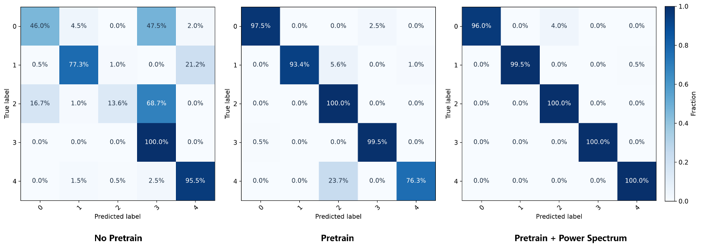
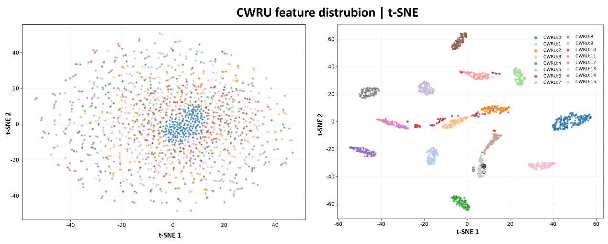
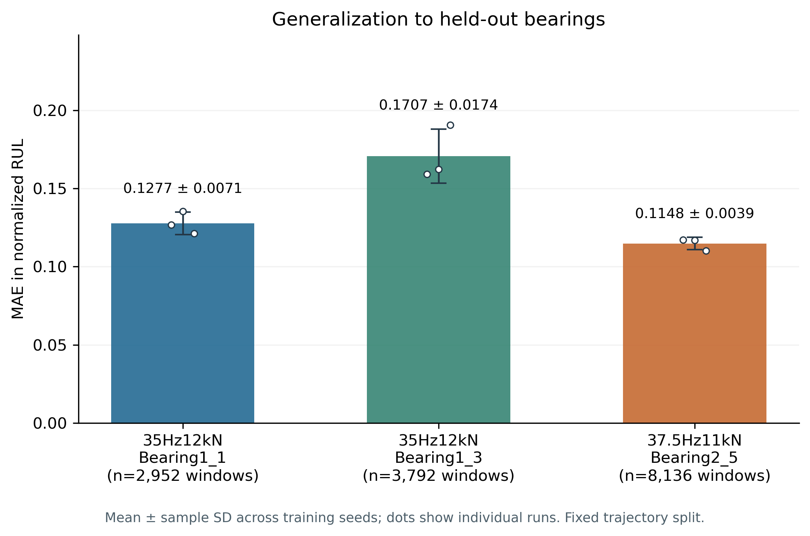

# Reference results / 参考结果

These tables summarize existing experiments, not a rerun of the clean export. FD tables are transcribed from the supplied manuscript `论文_引用加入.docx` as available on 2026-11-23; RUL values use the more precise three-seed experiment summary from 2026-11-18. Both use fixed partitions and report training-seed variability.

以下 FD 表格来自论文当前版本；RUL 采用三种子原始汇总的较高精度数值。FD 单位为准确率百分比，Full 指固定划分中的整个训练池，不包含测试数据。

## CWRU FD Accuracy (%)

| Model | 1-shot | 4-shot | 8-shot | 16-shot | 10% | Full |
|---|---:|---:|---:|---:|---:|---:|
| FS-PHM | 87.77 ± 0.25 | 93.29 ± 0.21 | 94.57 ± 0.13 | 95.29 ± 0.29 | 97.21 ± 0.05 | 99.02 ± 0.08 |
| FS-PHM + Power Spectrum | 94.15 ± 1.96 | 99.72 ± 0.39 | 99.98 ± 0.03 | 100.00 ± 0.00 | 100.00 ± 0.00 | 100.00 ± 0.00 |
| RmGPT | 39.52 ± 1.90 | 55.22 ± 2.11 | 67.53 ± 5.81 | 83.81 ± 5.12 | 95.88 ± 3.16 | 100.00 ± 0.00 |
| CNN_LSTM | 24.47 ± 7.99 | 54.08 ± 2.28 | 81.70 ± 3.16 | 92.55 ± 1.70 | 95.90 ± 2.01 | 98.41 ± 1.48 |
| ResNet18 | 83.23 ± 3.04 | 92.38 ± 1.68 | 92.11 ± 9.14 | 86.54 ± 21.09 | 97.16 ± 1.16 | 98.58 ± 1.48 |
| Transformer | 38.00 ± 6.33 | 65.86 ± 3.16 | 73.87 ± 2.33 | 83.26 ± 1.31 | 85.51 ± 2.61 | 94.36 ± 3.24 |
| Unifault | 68.84 ± 6.56 | 74.22 ± 4.08 | 80.11 ± 5.05 | 87.98 ± 2.84 | 92.59 ± 1.86 | 97.23 ± 1.62 |
| WDCNN | 8.59 ± 1.79 | 7.41 ± 1.92 | 9.43 ± 2.64 | 16.47 ± 4.28 | 75.62 ± 3.70 | 97.84 ± 0.88 |
| SC_MambaFew | 51.88 ± 7.12 | 56.40 ± 14.63 | 62.71 ± 15.51 | 92.46 ± 5.09 | 99.23 ± 0.43 | 99.04 ± 0.46 |

## UO FD Accuracy (%)

| Model | 1-shot | 4-shot | 8-shot | 16-shot | 10% | Full |
|---|---:|---:|---:|---:|---:|---:|
| FS-PHM | 79.09 ± 1.31 | 93.74 ± 1.14 | 96.33 ± 0.76 | 97.64 ± 0.62 | 99.43 ± 0.15 | 99.97 ± 0.06 |
| FS-PHM + Power Spectrum | 89.12 ± 4.25 | 99.93 ± 0.06 | 99.93 ± 0.06 | 100.00 ± 0.00 | 100.00 ± 0.00 | 100.00 ± 0.00 |
| RmGPT | 23.10 ± 1.77 | 25.99 ± 1.43 | 29.97 ± 3.42 | 33.54 ± 6.98 | 92.22 ± 3.27 | 100.00 ± 0.00 |
| CNN_LSTM | 41.28 ± 2.67 | 67.14 ± 5.32 | 81.25 ± 6.91 | 94.18 ± 2.08 | 99.49 ± 0.36 | 99.97 ± 0.06 |
| ResNet18 | 78.96 ± 11.08 | 91.04 ± 8.51 | 98.05 ± 0.62 | 96.33 ± 3.54 | 94.85 ± 8.84 | 100.00 ± 0.00 |
| Transformer | 48.22 ± 3.63 | 66.70 ± 10.76 | 80.91 ± 2.54 | 91.89 ± 0.78 | 98.05 ± 1.00 | 99.97 ± 0.06 |
| Unifault | 81.95 ± 4.07 | 92.83 ± 3.59 | 94.81 ± 1.88 | 96.43 ± 0.57 | 97.88 ± 0.27 | 99.60 ± 0.17 |
| WDCNN | 20.71 ± 0.80 | 23.60 ± 3.70 | 20.00 ± 0.00 | 20.00 ± 0.00 | 79.80 ± 2.72 | 99.56 ± 0.76 |
| SC_MambaFew | 39.43 ± 10.15 | 39.66 ± 8.99 | 33.00 ± 4.88 | 59.49 ± 20.36 | 100.00 ± 0.00 | 100.00 ± 0.00 |

## XJTU-SY RUL

The training pool contains 206,304 windows from 12 bearings; TEST contains 14,880 windows from Bearing1_1, Bearing1_3 and Bearing2_5. The trajectory split seed is 2026; training seeds are 2026/2027/2028. Metrics are computed on the entire test partition per run and then averaged, with sample standard deviation (ddof=1).

| Model | MAE ↓ | MSE ↓ | RMSE ↓ |
|---|---:|---:|---:|
| FS-PHM frozen fusion regressor | 0.13158 ± 0.00163 | 0.02624 ± 0.00087 | 0.16196 ± 0.00269 |
| DA-RUL adaptation | 0.16829 ± 0.01369 | 0.04800 ± 0.00821 | 0.21859 ± 0.01835 |
| Transformer | 0.19593 ± 0.01803 | 0.05758 ± 0.01189 | 0.23914 ± 0.02425 |
| ResNet18 | 0.22271 ± 0.07474 | 0.08682 ± 0.06579 | 0.28177 ± 0.10552 |
| CNN-LSTM | 0.23613 ± 0.01856 | 0.08708 ± 0.01680 | 0.29414 ± 0.02893 |
| MOMENT/T5 community implementation | 0.26200 ± 0.01052 | 0.11759 ± 0.01029 | 0.34269 ± 0.01520 |
| CNN-BiLSTM adaptation | 0.26780 ± 0.03381 | 0.11179 ± 0.02405 | 0.33298 ± 0.03706 |
| Dual-Mixer adaptation | 0.27110 ± 0.04014 | 0.11568 ± 0.03777 | 0.33728 ± 0.05361 |

The manuscript's RUL row labeled RmGPT with MAE 0.2620 is corrected here to MOMENT/T5 community implementation. The separately packaged paper-derived RmGPT is a different model. History-based adapters used history=1; these are adapted comparisons, not claims of reproducing complete original-paper protocols.

RUL figures reflect the full-pool version, not the historical 17,192-window MAE 0.124295 run. The ± statistics describe training-seed variation, not confidence intervals or uncertainty over independent test splits. The fixed test results were viewed during earlier development; they are not presented as a previously unseen blind evaluation.

## Figures / 图

The confusion matrices and t-SNE are manuscript examples from individual runs. RUL error plots were generated on 2026-11-19 using the full-pool three-seed predictions. Figures are descriptive and do not replace aggregate test metrics.
