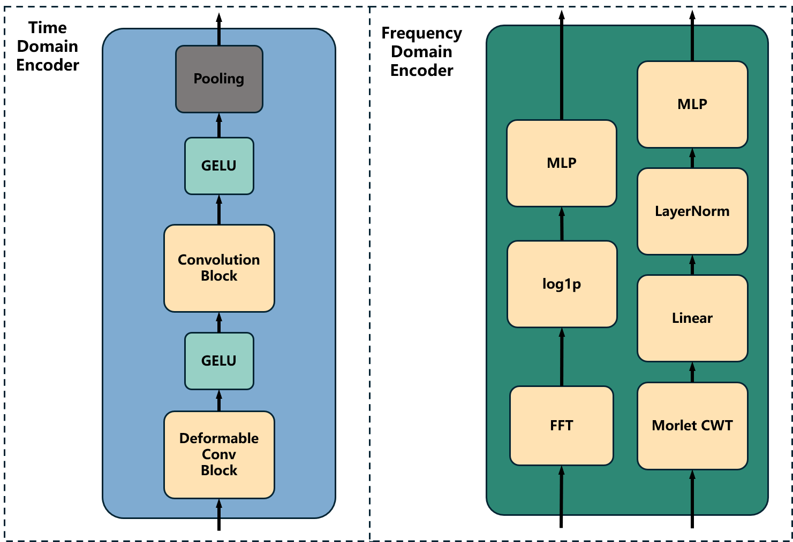
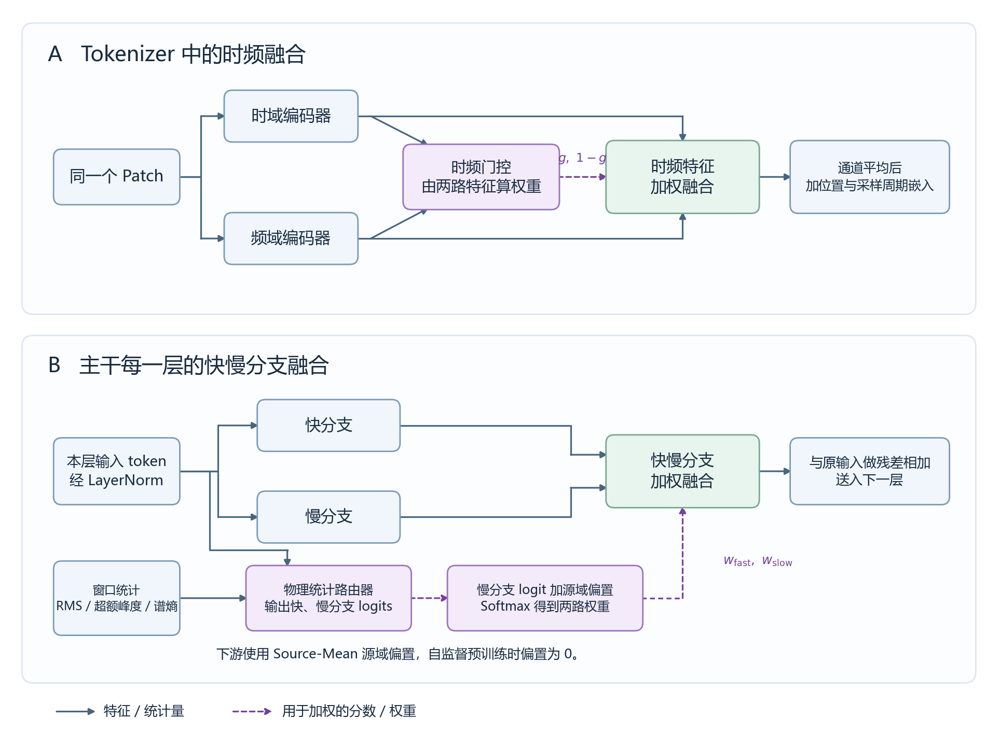
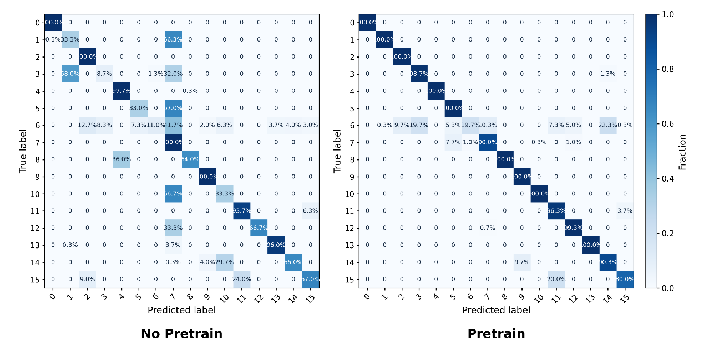

# Reference results / 参考结果

FS-PHM results use the Source-Mean calibrated checkpoint and the fixed test partitions. All values are the mean ± sample standard deviation across three training runs. Full uses the entire training pool.

FS-PHM 结果使用 Source-Mean 校准后的检查点及固定测试集。表中为三次训练的均值 ± 样本标准差，Full 指完整训练池。

## CWRU FD Accuracy (%)

| Model | 1-shot | 4-shot | 8-shot | 16-shot | 10% | Full |
|---|---:|---:|---:|---:|---:|---:|
| FS-PHM | 86.05 ± 1.42 | 93.39 ± 0.31 | 94.97 ± 0.32 | 95.76 ± 0.37 | 97.23 ± 0.13 | 99.11 ± 0.00 |
| RmGPT | 39.52 ± 1.90 | 55.22 ± 2.11 | 67.53 ± 5.81 | 83.81 ± 5.12 | 95.88 ± 3.16 | 100.00 ± 0.00 |
| CNN_LSTM | 24.47 ± 7.99 | 54.08 ± 2.28 | 81.70 ± 3.16 | 92.55 ± 1.70 | 95.90 ± 2.01 | 98.41 ± 1.48 |
| ResNet18 | 83.23 ± 3.04 | 92.38 ± 1.68 | 92.11 ± 9.14 | 86.54 ± 21.09 | 97.16 ± 1.16 | 98.58 ± 1.48 |
| Transformer | 38.00 ± 6.33 | 65.86 ± 3.16 | 73.87 ± 2.33 | 83.26 ± 1.31 | 85.51 ± 2.61 | 94.36 ± 3.24 |
| Unifault | 68.84 ± 6.56 | 74.22 ± 4.08 | 80.11 ± 5.05 | 87.98 ± 2.84 | 92.59 ± 1.86 | 97.23 ± 1.62 |
| WDCNN | 8.59 ± 1.79 | 7.41 ± 1.92 | 9.43 ± 2.64 | 16.47 ± 4.28 | 75.62 ± 3.70 | 97.84 ± 0.88 |
| SC_MambaFew | 51.88 ± 7.12 | 56.40 ± 14.63 | 62.71 ± 15.51 | 92.46 ± 5.09 | 99.23 ± 0.43 | 99.04 ± 0.46 |

## UO FD Accuracy (%)

| Model | 1-shot | 4-shot | 8-shot | 16-shot | 10% | Full |
|---|---:|---:|---:|---:|---:|---:|
| FS-PHM | 89.16 ± 5.65 | 95.15 ± 0.10 | 96.73 ± 0.47 | 97.78 ± 0.51 | 99.26 ± 0.06 | 99.83 ± 0.06 |
| RmGPT | 23.10 ± 1.77 | 25.99 ± 1.43 | 29.97 ± 3.42 | 33.54 ± 6.98 | 92.22 ± 3.27 | 100.00 ± 0.00 |
| CNN_LSTM | 41.28 ± 2.67 | 67.14 ± 5.32 | 81.25 ± 6.91 | 94.18 ± 2.08 | 99.49 ± 0.36 | 99.97 ± 0.06 |
| ResNet18 | 78.96 ± 11.08 | 91.04 ± 8.51 | 98.05 ± 0.62 | 96.33 ± 3.54 | 94.85 ± 8.84 | 100.00 ± 0.00 |
| Transformer | 48.22 ± 3.63 | 66.70 ± 10.76 | 80.91 ± 2.54 | 91.89 ± 0.78 | 98.05 ± 1.00 | 99.97 ± 0.06 |
| Unifault | 81.95 ± 4.07 | 92.83 ± 3.59 | 94.81 ± 1.88 | 96.43 ± 0.57 | 97.88 ± 0.27 | 99.60 ± 0.17 |
| WDCNN | 20.71 ± 0.80 | 23.60 ± 3.70 | 20.00 ± 0.00 | 20.00 ± 0.00 | 79.80 ± 2.72 | 99.56 ± 0.76 |
| SC_MambaFew | 39.43 ± 10.15 | 39.66 ± 8.99 | 33.00 ± 4.88 | 59.49 ± 20.36 | 100.00 ± 0.00 | 100.00 ± 0.00 |

## XJTU-SY RUL

The training pool contains 206,304 windows from 12 bearings; TEST contains 14,880 windows from Bearing1_1, Bearing1_3 and Bearing2_5. The trajectory split seed is 2026; training seeds are 2026/2027/2028. Metrics are computed on the entire test partition per run and then averaged, with sample standard deviation (ddof=1).

| Model | MAE ↓ | MSE ↓ | RMSE ↓ |
|---|---:|---:|---:|
| FS-PHM frozen fusion regressor | 0.13023 ± 0.00387 | 0.02655 ± 0.00136 | 0.16290 ± 0.00418 |
| DA-RUL adaptation | 0.16829 ± 0.01369 | 0.04800 ± 0.00821 | 0.21859 ± 0.01835 |
| Transformer | 0.19593 ± 0.01803 | 0.05758 ± 0.01189 | 0.23914 ± 0.02425 |
| ResNet18 | 0.22271 ± 0.07474 | 0.08682 ± 0.06579 | 0.28177 ± 0.10552 |
| CNN-LSTM | 0.23613 ± 0.01856 | 0.08708 ± 0.01680 | 0.29414 ± 0.02893 |
| MOMENT/T5 community implementation | 0.26200 ± 0.01052 | 0.11759 ± 0.01029 | 0.34269 ± 0.01520 |
| CNN-BiLSTM adaptation | 0.26780 ± 0.03381 | 0.11179 ± 0.02405 | 0.33298 ± 0.03706 |
| Dual-Mixer adaptation | 0.27110 ± 0.04014 | 0.11568 ± 0.03777 | 0.33728 ± 0.05361 |

The manuscript's RUL row labeled RmGPT with MAE 0.2620 is corrected here to MOMENT/T5 community implementation. The separately packaged paper-derived RmGPT is a different model. History-based adapters used history=1; these are adapted comparisons, not claims of reproducing complete original-paper protocols.

RUL figures reflect the full-pool version, not the historical 17,192-window MAE 0.124295 run. The ± statistics describe training-seed variation, not confidence intervals or uncertainty over independent test splits. The fixed test results were viewed during earlier development; they are not presented as a previously unseen blind evaluation.

## Branch and router ablations

The variants share the joint pretraining checkpoint. FD uses one support window per class, and RUL uses the full training pool. Accuracy, macro F1, and macro recall are percentages.

| Variant | CWRU Acc. | CWRU F1 | CWRU Recall | UO Acc. | UO F1 | UO Recall | XJTU MAE | XJTU MSE | XJTU RMSE |
| --- | ---: | ---: | ---: | ---: | ---: | ---: | ---: | ---: | ---: |
| Without fast | 78.58 ± 2.77 | 71.72 ± 3.55 | 74.54 ± 3.30 | 85.56 ± 1.67 | 84.92 ± 1.80 | 85.56 ± 1.67 | 0.13684 ± 0.00569 | 0.03047 ± 0.00299 | 0.17442 ± 0.00847 |
| Without slow | 84.23 ± 1.29 | 77.89 ± 1.64 | 81.25 ± 1.53 | 85.39 ± 2.22 | 85.30 ± 2.28 | 85.39 ± 2.22 | 0.12845 ± 0.00398 | 0.02504 ± 0.00110 | 0.15822 ± 0.00346 |
| Fixed 50/50 | 83.42 ± 1.52 | 77.65 ± 2.60 | 80.29 ± 1.81 | 83.00 ± 0.71 | 82.53 ± 0.81 | 83.00 ± 0.71 | 0.12023 ± 0.00579 | 0.02198 ± 0.00241 | 0.14810 ± 0.00827 |
| Full model | 86.05 ± 1.42 | 80.80 ± 1.61 | 83.42 ± 1.68 | 89.16 ± 5.65 | 88.81 ± 6.01 | 89.16 ± 5.65 | 0.13023 ± 0.00387 | 0.02655 ± 0.00136 | 0.16290 ± 0.00418 |

## Pretraining sources

All checkpoints are matched at 3,134 optimizer updates and use the same Source-Mean offsets. The rows use the full model. FD values are accuracies in percent.

| Pretraining | CWRU 1-shot | CWRU 4-shot | CWRU 8-shot | CWRU 16-shot | UO 1-shot | UO 4-shot | UO 8-shot | UO 16-shot | XJTU MAE | XJTU MSE | XJTU RMSE |
| --- | ---: | ---: | ---: | ---: | ---: | ---: | ---: | ---: | ---: | ---: | ---: |
| Joint | 86.05 ± 1.42 | 93.39 ± 0.31 | 94.97 ± 0.32 | 95.76 ± 0.37 | 89.16 ± 5.65 | 95.15 ± 0.10 | 96.73 ± 0.47 | 97.78 ± 0.51 | 0.13023 ± 0.00387 | 0.02655 ± 0.00136 | 0.16290 ± 0.00418 |
| FD only | 74.17 ± 5.05 | 82.97 ± 0.88 | 86.70 ± 0.05 | 88.64 ± 0.34 | 79.46 ± 2.62 | 94.11 ± 0.51 | 92.36 ± 0.62 | 93.40 ± 1.35 | 0.18785 ± 0.00724 | 0.05752 ± 0.00315 | 0.23978 ± 0.00661 |
| RUL only | 81.18 ± 1.76 | 90.76 ± 0.88 | 91.43 ± 1.00 | 92.73 ± 0.62 | 83.64 ± 4.50 | 94.98 ± 1.36 | 95.08 ± 0.84 | 97.44 ± 0.15 | 0.16929 ± 0.01108 | 0.04548 ± 0.00585 | 0.21298 ± 0.01353 |

## Figures / 图

The confusion matrices pool predictions from three runs and normalize by true class. The pretrained panels use the Source-Mean model. The following plots use earlier models with the original router.

