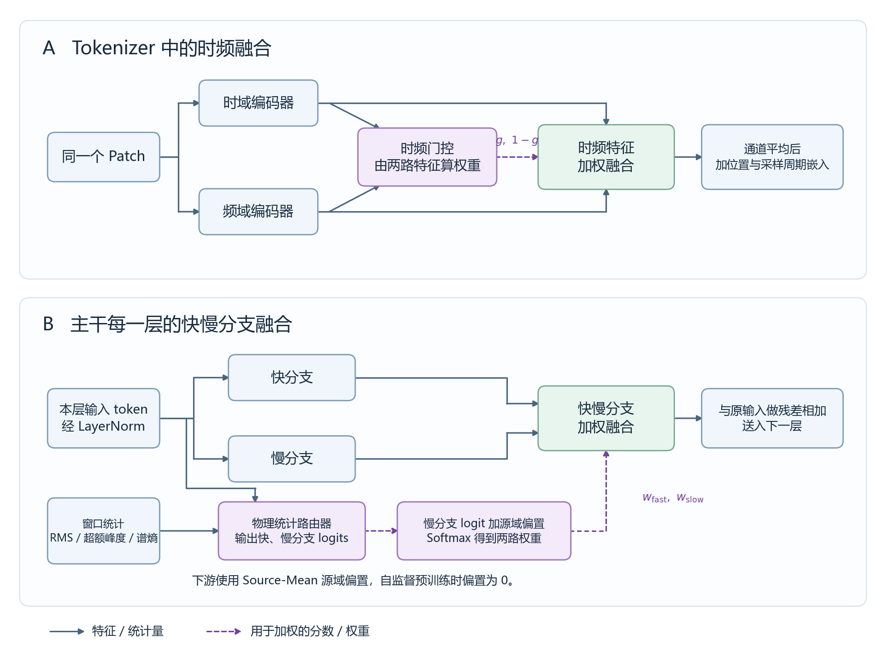

# Source-Mean routing

The tokenizer combines time- and frequency-domain features with a learned feature-wise gate. Each backbone layer combines its fast and slow outputs using a separate router. The router receives the current normalized token and the window's RMS, excess kurtosis, and normalized spectral entropy.



Source-Mean calibration freezes the pretrained backbone and fits a 42-parameter projection on 32 labeled source episodes from JNU, PU, IMS and PHM2012 (648 distinct labeled windows). The six statistics of each support set come from the means and population standard deviations of transformed groupwise RMS, kurtosis, and spectral entropy. Evaluating the fitted projection at the mean source context gives one offset per layer. Each offset is added to the slow-branch logit before softmax.

Use the fitted offsets in [the calibration record](../model/source_mean.json) to prepare a checkpoint for both downstream tasks.

```bash
python -m model.apply_source_mean \
  --checkpoint runs/fs_phm_pretrain/epoch_0002.pt \
  --output runs/fs_phm_pretrain/source_mean.pt
```

The output contains foundation weights and model configuration for `model.train_finetune` and `model.train_rul_frozen`. The bundled values apply the existing calibration. Training the projection again would require the labeled source episodes and the original calibration procedure. Exact reproduction of the reported metrics requires the original foundation checkpoint, identified by its SHA-256 in the calibration record.

For the branch ablations, repeat the command from the same uncalibrated checkpoint with `--branch-ablation no-fast`, `no-slow`, or `uniform-router` and a separate output path. For the pretraining-source comparison, apply the same offsets to the joint, FD-only and RUL-only checkpoints at 3,134 optimizer updates. The outcomes for these settings are in [the results tables](results.md).

